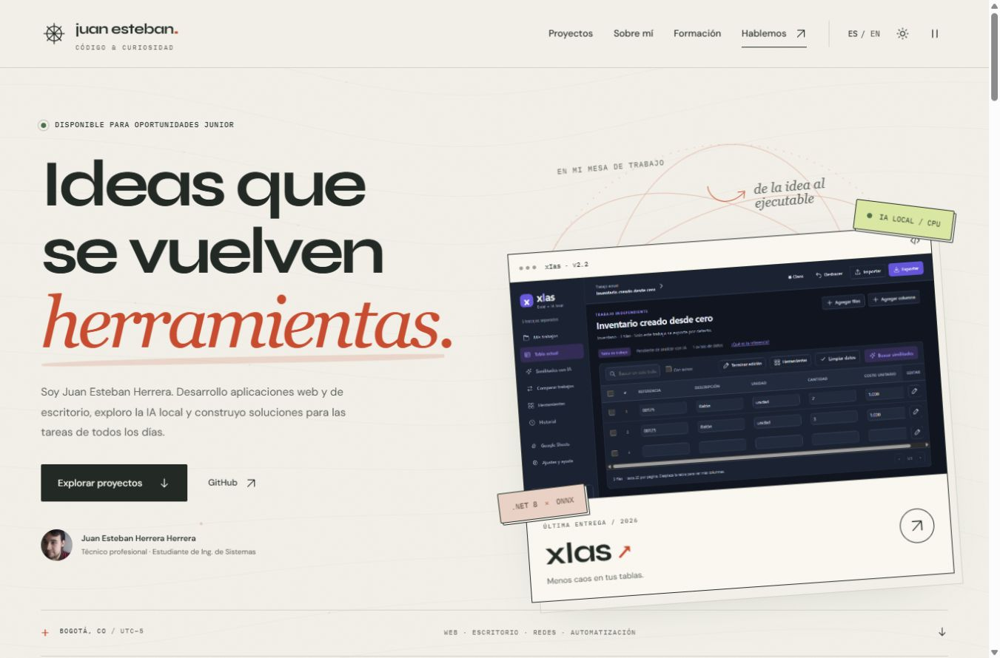

# Juan Esteban Herrera · Código & curiosidad

Portafolio personal de Juan Esteban Herrera Herrera. Una bitácora visual de aplicaciones, IA local, backend, escritorio y redes, con proyectos personales, académicos y colaborativos.



## Qué incluye

- Diseño editorial con textura de papel, líneas de fondo animadas y una mesa de trabajo que presenta xIas.
- Tema claro y oscuro, español e inglés, menú móvil y control de animaciones.
- 18 proyectos: seis seleccionados y doce exploraciones en el archivo.
- Casos con problema, aporte personal, tecnologías, límites y enlaces al código, las demos o las descargas disponibles.
- Capturas reales de xIas, Recorta y LogiTree. Las demás portadas son ilustraciones y se identifican como tales en sus casos.
- Formación actualizada, herramientas con contexto y buscador de 48 cursos y rutas de formación.
- Fuentes, imágenes e iconos incluidos; sin dependencias de ejecución, analítica ni formularios que envíen datos.

## Abrir el portafolio

Extrae la carpeta y abre **index.html** en un navegador moderno. No abras el HTML dentro del ZIP. Mantén junto al archivo las carpetas assets, css, data y js.

El sitio usa scripts clásicos y recursos relativos para permitir la apertura como archivo. Algunas funciones del navegador, como copiar el correo, pueden depender de sus permisos; se muestra una alternativa si no están disponibles.

Para previsualizarlo por HTTP, con Node.js 18 o posterior instalado:

```text
npm run preview
```

Abre http://127.0.0.1:8080. Detén la vista previa con Ctrl+C. No hace falta instalar paquetes ni ejecutar npm install.

## Actualizar el repositorio de GitHub Pages

1. Conserva una copia de la versión actual.
2. Copia **el contenido de esta carpeta** a la raíz del repositorio Portafolio: index.html debe quedar en la raíz.
3. Incluye los archivos ocultos .nojekyll y .gitignore. Conserva la carpeta .git de tu repositorio si trabajas con una copia local.
4. Guarda los cambios y súbelos a la rama que ya publica tu GitHub Pages.
5. Revisa https://juanestebanherrerah.github.io/Portafolio/ cuando termine la publicación.

Este paquete no modifica automáticamente el repositorio ni publica cambios. No necesita un backend ni un proceso de compilación para alojarse en GitHub Pages.

## Editar proyectos y formación

1. Modifica data/content.json.
2. Ejecuta npm run sync para regenerar data/content.js.
3. Ejecuta npm run check.
4. Revisa la página en escritorio y móvil.

Las dos versiones del contenido se incluyen para mantener una fuente legible en JSON y permitir abrir el sitio sin un servidor. Publica ambas después de editar.

Los textos de portada, perfil, contacto y SEO están en index.html; sus traducciones al inglés están en js/app.js. Consulta [la guía de contenido](docs/CONTENIDO.md) antes de cambiarlos.

## Estructura

- index.html: contenido principal, navegación, metadatos y estructura accesible.
- css/style.css: diseño adaptable, temas, textura, animaciones y estilos de impresión.
- data/content.json: proyectos, educación, herramientas y certificados.
- data/content.js: copia generada del contenido.
- js/app.js: filtros, buscadores, diálogos, idioma y preferencias.
- js/background.js: fondo animado ligero en Canvas.
- assets/: fotografía, imágenes, SVG y tipografías locales.
- scripts/: sincronización de datos, revisión de integridad y servidor de vista previa.
- docs/: mantenimiento, diseño, recursos y verificación.

## Documentación

- [Editar información y proyectos](docs/CONTENIDO.md)
- [Diseño, accesibilidad y rendimiento](docs/DISENO.md)
- [Recursos y créditos](docs/RECURSOS.md)
- [Pruebas realizadas y límites](docs/VERIFICACION.md)

## Información profesional

El perfil presenta el título de Técnico Profesional en Soporte de Sistemas e Informática obtenido el 26 de febrero de 2026 y la Ingeniería de Sistemas en curso. La experiencia se describe mediante proyectos, sin convertirla en empleo formal. LogiTree y Dotaciones App se identifican como colaborativos.

Los certificados conservan sus enlaces originales; sus nombres no equivalen todos a certificaciones profesionales. Cada aplicación mantiene sus propios requisitos y licencias.

Los textos, la fotografía y la identidad pertenecen a su titular. Las tipografías incluyen sus licencias OFL en assets/fonts. Este paquete no añade una licencia general de código abierto a todo el portafolio.
