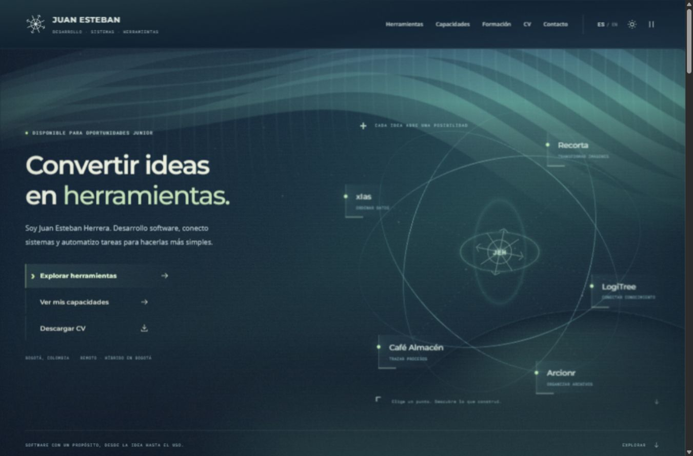

# Juan Esteban Herrera · Aurora

Portafolio de desarrollo, sistemas y herramientas. Una escena interactiva con auroras abre el recorrido; el visitante elige una aplicación, explora su uso y consulta su implementación.



## Experiencia

- Encabezado con cielo animado, rueda de marca, órbitas y puntos que llevan a proyectos reales.
- Movimiento activado al entrar, con opción de pausa y preferencia guardada.
- Tipografías locales: Montserrat, Open Sans y Roboto Mono.
- Explorador único de 18 herramientas, con búsqueda y filtros. Una herramienta se muestra a la vez, en una vista amplia.
- Casos con flujo de uso, propósito, participación, implementación y límites.
- Cinco áreas de conocimiento: redes/soporte, web/backend, escritorio/IA local, ofimática e IA/automatización.
- Tres hitos visibles: título técnico obtenido, formación ONE/Alura e Ingeniería de Sistemas en curso.
- 48 cursos y rutas organizados por áreas, con explicación, buscador y carga progresiva.
- Cuatro CV descargables: desarrollo, soporte/redes, ofimática y desarrollo ENG.
- Español/inglés, modo claro/oscuro y diseño adaptable.

La paleta cálida de las secciones se conserva. La barra de progreso, la numeración de secciones, las tarjetas de catálogo y el bloque separado de exploraciones se retiraron.

## Abrir

Extrae el ZIP y abre **index.html**. Mantén juntas todas las carpetas. El sitio usa recursos relativos y scripts clásicos para permitir abrirlo sin instalar herramientas.

Para la vista por HTTP, con Node.js 18 o posterior:

```text
npm run preview
```

Abre http://127.0.0.1:8080. Detén la vista previa con Ctrl+C. No es necesario instalar paquetes.

## Actualizar GitHub Pages

1. Conserva una copia de tu versión actual.
2. Copia el contenido de esta carpeta a la raíz del repositorio Portafolio. index.html debe quedar en la raíz.
3. Incluye .nojekyll, .gitignore, assets/cv y las fuentes. Conserva la carpeta .git si trabajas sobre una copia local del repositorio.
4. Guarda y sube los cambios a la rama que ya publica GitHub Pages.
5. Comprueba https://juanestebanherrerah.github.io/Portafolio/ después de la publicación.

No se ha modificado la web pública desde este paquete.

## Contenido y mantenimiento

Edita data/content.json para modificar proyectos y capacidades. Luego ejecuta:

```text
npm run sync
npm run check
```

Los textos de portada y perfil están en index.html; la traducción al inglés y los textos de hitos/CV están en js/app.js. Consulta [la guía de contenido](docs/CONTENIDO.md).

## CV

Los cuatro archivos se encuentran en assets/cv y son copias de los PDF ATS de octubre de 2026 disponibles en el espacio de trabajo. Se han añadido como descargas; su contenido no se ha reescrito en esta revisión del sitio.

Al publicar el portafolio, esos PDF formarán parte de los archivos públicos. Para sustituirlos, conserva los nombres o actualiza las referencias en js/app.js y en el bloque noscript de index.html.

## Documentación

- [Contenido y archivos](docs/CONTENIDO.md)
- [Diseño y rendimiento](docs/DISENO.md)
- [Recursos y fuentes de información](docs/RECURSOS.md)
- [Verificación](docs/VERIFICACION.md)

No requiere servicios, claves, modelos de IA ni base de datos para funcionar. No utiliza analítica ni envía formularios. Los enlaces externos abren sus propios sitios.

La identidad, fotografía y contenido profesional pertenecen a su titular. Las fuentes incluyen sus licencias OFL. No se añade una licencia general al portafolio ni se reutilizan imágenes, música, logotipos o recursos de Halo o Jujutsu Kaisen.
