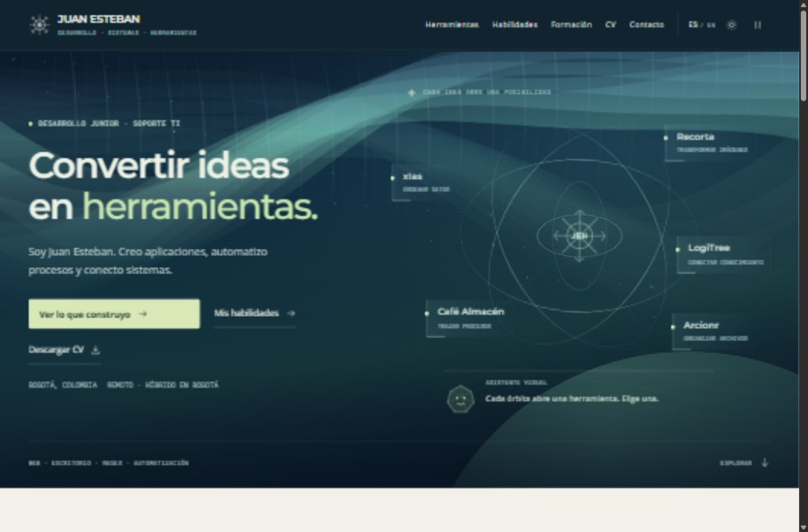

# Juan Esteban Herrera · Aurora

Portafolio de Juan Esteban Herrera: aplicaciones, sistemas y herramientas con demostraciones interactivas y acceso a sus repositorios.

**[Visitar el portafolio](https://juanestebanherrerah.github.io/Portafolio/) · [Perfil de GitHub](https://github.com/JuanEstebanHerreraH)**

## Qué incluye

- Escena de átomo con cinco accesos a proyectos.
- Aurora animada por capas, sin redibujar un Canvas en cada fotograma.
- Asistente visual con mensajes preparados al explorar las órbitas.
- Cinco demostraciones: consulta de productos, vista de recorte, subnetting, limpieza/suma de una tabla y organización de archivos.
- Tecnologías y herramientas de evidencia junto a cada demostración.
- 18 proyectos con capturas o ilustraciones identificadas; un caso se abre a la vez.
- Tres hitos de formación y cursos complementarios en un bloque desplegable.
- Cuatro CV PDF: desarrollo, soporte TI, ofimática y desarrollo en inglés.
- Footer en azul petróleo y verdes, coherente con la portada.

La sección Experiencia incluye servicios freelance desde enero de 2023 y la práctica en gestión documental y recursos digitales en la CUN, de agosto a noviembre de 2025. Los proyectos personales, académicos y colaborativos se describen por separado.

## Movimiento y móvil

En escritorio se animan dos capas de aurora, las órbitas y la rueda central. Hasta 980 px se conserva una capa de aurora y el giro del átomo. La tipografía de lectura sigue en 16–18 px.

El movimiento se pausa fuera de la portada, al ocultar la pestaña o al usar el botón de pausa. La primera visita respeta la preferencia de movimiento reducido; el botón permite activar el movimiento de forma explícita y guardar esa elección.

La revisión de tamaños de pantalla no sustituye una medición de FPS en un teléfono físico.

## Qué hacen las demostraciones

Las interacciones de tabla, red y nombres de archivos calculan sus resultados sobre datos de ejemplo. La API es una consulta simulada sobre datos incluidos; la imagen alterna una ilustración con/sin fondo.

El asistente usa respuestas preparadas. Esta web no ejecuta inferencia, segmentación ni OCR, no descarga modelos de IA ni envía archivos. Las funciones de IA reales se explican en los repositorios de las aplicaciones.

## Abrir

Clona o descarga el repositorio y abre **index.html**, conservando todas las carpetas. Para la vista estática no necesitas instalar paquetes.

Vista por HTTP opcional con Node.js 18 o posterior:

~~~text
npm run preview
~~~

Abre http://127.0.0.1:8080. Detén el servidor con Ctrl+C.

## Publicación

El sitio público está en [GitHub Pages](https://juanestebanherrerah.github.io/Portafolio/). Para actualizarlo, sube los cambios a la fuente configurada para Pages y comprueba la portada, las demostraciones y los enlaces a CV.

## Mantenimiento

Edita data/content.json para proyectos y formación. Después:

~~~text
npm run sync
npm run check
~~~

Textos y navegación: index.html y js/app.js. Atmósfera/asistente: js/aurora.js y assets/aurora-*.svg. Demostraciones: js/skills.js.

- [Contenido](docs/CONTENIDO.md)
- [Diseño y rendimiento](docs/DISENO.md)
- [Verificación](docs/VERIFICACION.md)
- [Recursos](docs/RECURSOS.md)

Los CV están disponibles desde la web. Las fuentes locales incluyen sus licencias OFL. El sitio no requiere claves, cuenta, base de datos ni servicio de IA.

